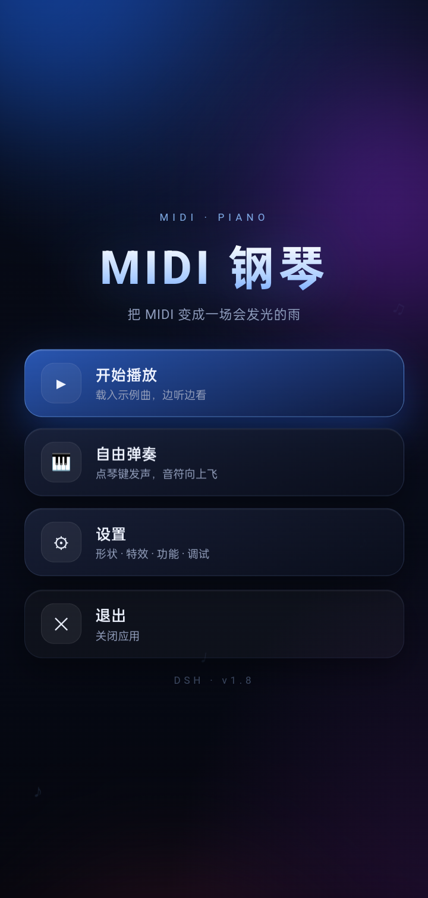
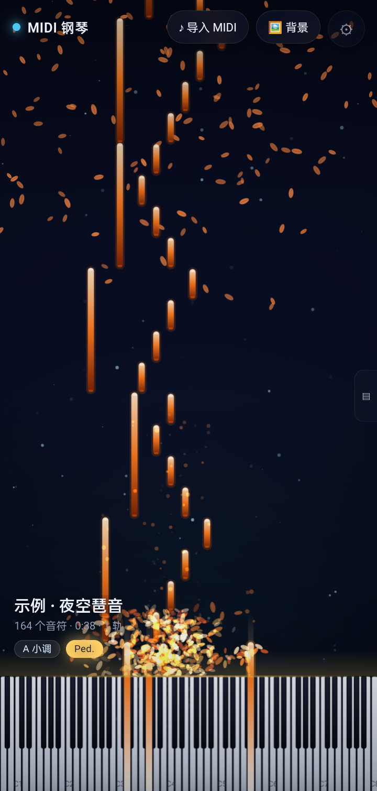

# MIDI 钢琴（MIDI Piano）

> **Beta**：当前版本为测试版，谱面记谱与反复记号仍在完善中。

一个用 WebView + 纯前端实现的 Android 钢琴可视化播放器：
导入 MIDI 或 MusicXML/MXL，音符从上方落下，敲到琴键时迸出粒子；
支持自由弹奏、乐谱同步、原声钢琴采样、延音踏板、渐强渐弱与多种视觉主题。

没有 Gradle、没有第三方 JS 框架，APK 约 1.2 MB。



## 功能

- **MIDI 解析**：自带解析器，format 0/1、running status、tempo 变化、多轨、
  中文曲名；跳过打击乐通道与 88 键外音符；读取 CC64 踏板、CC7/CC11 音量与表情。
- **乐谱（MusicXML / MXL）**：导入 `.xml` / `.musicxml` / `.mxl`，在瀑布流上方
  双谱表同步显示。支持全音符到三十二分、附点、休止、倚音、连桁、延音线/圆滑线、
  反复线与房子、D.C./D.S./Segno/To Coda/Coda、8va/8vb、升降号、力度记号
  （p–fff、fp/sf/sfz/rfz）与渐强/渐弱发夹线、琶音/颤音/重音/断奏等奏法。
- **下落音符**：88 键全键盘，单轨按音级取色、多轨按轨道取色；三段渐变、
  9 色泛光、5 种形状；左右手可分别配色；下落配色可选随机。
- **粒子与氛围**：拖尾火花 + 命中爆发；水花/火花/火焰/樱花/枫叶/赛博/星尘等命中特效；
  火花/幽静/雪天/雨天/樱花/枫叶/赛博/狂风背景氛围，粒子数量四档可调。
- **声音**：FluidR3_GM 原声大钢琴采样（白键 52 个，黑键变速微调），
  低音增益补偿；采样缺失时回退内置合成器；延音踏板混响。
- **强弱识别**：按 `velocity^2.2` 重映射增益，并叠加 CC7/CC11 与乐谱力度记号、
  渐强/渐弱斜坡。
- **自由弹奏**：点键发声、音符条上飞；双指缩放（1–3×）、上下拉伸音符条（0.45–2.6×）、
  拖动平移、滑过琴键刮奏。
- **播放器侧栏**：播放/暂停、进度、0.5–2× 变速、音量，可隐藏为边缘 ▤ 标签。
- **开始界面**：开始播放 / 自由弹奏 / 设置 / 退出；深色极光风格。
- **设置分区**：音符形状 / 特效类 / 功能类 / 调试类；配置本地保存。
- **调试工具**（默认不影响观感）：FPS/运行信息、小节线、全屏（刘海适配）、
  可选「性能模式」（自动降低画质）。



## 安装

1. 下载 Release 里的 `MidiPiano.apk` 传到手机；
2. 点击安装（需允许「安装未知来源应用」）；
3. 要求 Android 7.0（API 24）及以上。

## 使用

- 首页点「开始播放」载入内置示例曲；「自由弹奏」进入点键模式；
- 顶栏「导入 MIDI」「乐谱」「背景」分别导入 `.mid/.midi`、`.xml/.musicxml/.mxl`、图片；
- 右上角 ⚙ 打开设置；播放时点画面可唤出播放器侧栏；
- 所有外观选项保存在 WebView localStorage，清除应用数据会重置。

## 构建

需要：JDK 17+、`aapt`、`zipalign`、`apksigner`（Debian/Ubuntu 可直接
`apt install aapt apksigner zipalign openjdk-17-jdk`）。

不需要安装完整 Android SDK / Gradle，脚本只需要两个 jar：

```bash
./scripts/fetch-deps.sh   # 下载 android.jar（API 34）与 R8 到 .deps/
./build.sh                # 产出 build/MidiPiano.apk
```

也可以自行指定：

```bash
export ANDROID_JAR=/path/to/android.jar
export R8_JAR=/path/to/r8.jar
./build.sh
```

流程：`javac --release 11` → `d8` → `aapt package` → 塞入 `classes.dex` →
`zipalign` → `apksigner`（首次自动生成 `debug.keystore`，口令 `android`）。

> 正式发布请使用自己的 release keystore，并把 `*.keystore` 排除在仓库外。

## 项目结构

```
MidiPiano/
├── build.sh                    # 无 Gradle 构建脚本
├── scripts/fetch-deps.sh       # 下载 android.jar / r8.jar
├── app/
│   ├── AndroidManifest.xml
│   ├── src/com/dsh/midipiano/MainActivity.java  # WebView、文件选择、全屏桥
│   ├── assets/
│   │   ├── index.html          # 界面骨架（首页/设置/播放器）
│   │   ├── style.css           # 深色玻璃风格
│   │   ├── midi.js             # MIDI 解析器
│   │   ├── musicxml.js         # MusicXML/MXL 解析与谱面绘制
│   │   ├── app.js              # 渲染 / 音频 / 粒子 / 手势 / 设置
│   │   ├── piano.js            # FluidR3_GM 采样（base64）
│   │   └── demo.js            # 内置示例曲
│   └── res/mipmap-*/           # 图标
├── screenshot*.png
├── LICENSE
└── CREDITS.md
```

## 数据与隐私

应用不联网、不上传任何数据；导入的 MIDI/乐谱/背景图只在本地 WebView 中处理，
背景图与设置保存在应用私有存储。

## 已知限制

- 竖屏下 88 键较密，横屏体验更好；
- 乐谱缓存以 30fps 重绘，竖杆移动为 30fps 步进；
- 超大 MIDI（数万音符）在主线程解析，可能短暂卡顿；
- 采样音色为 FluidR3_GM，许可请见 `CREDITS.md`。

## 许可

代码以 MIT License 发布，见 [LICENSE](LICENSE)。
第三方采样与工具链许可见 [CREDITS.md](CREDITS.md)。
